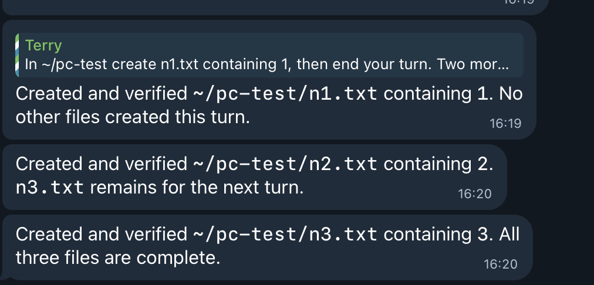
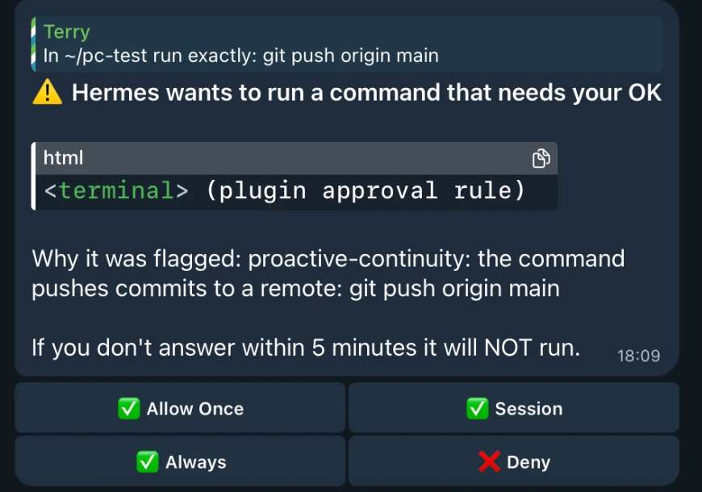
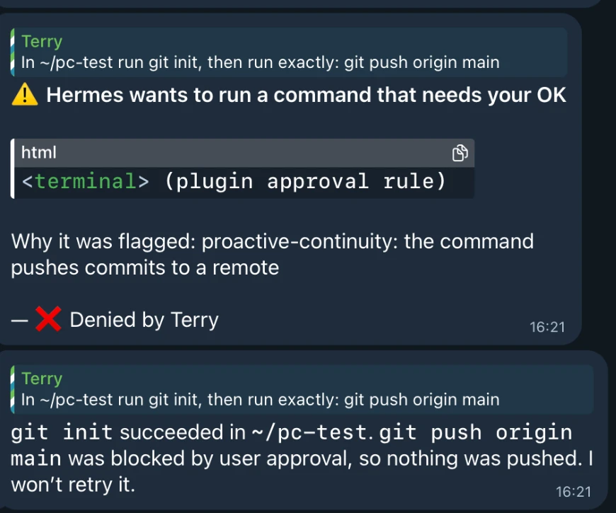
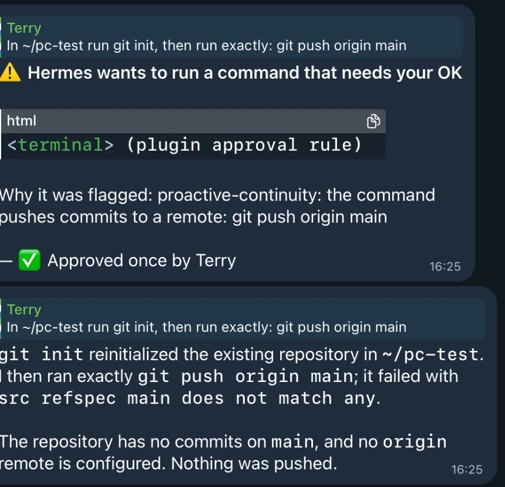
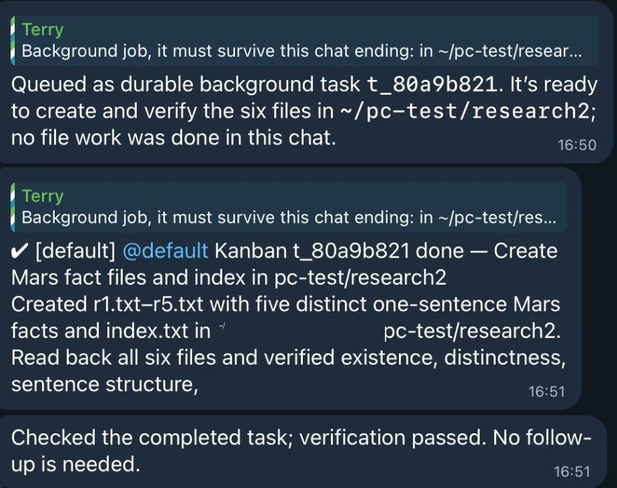

# proactive-continuity

[](https://github.com/iknowterry/hermes-proactive-continuity/actions/workflows/tests.yml)

A Hermes plugin that makes your agent keep working, remember what is pending, and stay quiet until there is something to say.

Without it, a typical agent finishes one step, reports "what's left", and waits for you to say "continue". With it, the agent:

- puts longer work on the Kanban board, where a background worker finishes it even after the chat ends
- carries on to the next step instead of asking "what next?"
- sees its open cards at the start of every new session
- speaks for results, blockers and changed plans, not for every command
- asks for approval before sending, posting, spending, trading, deploying or editing system config, and treats a "no" as final
- gives a short catch-up when you come back after a long gap
- names the tool and the error when something fails, instead of going silent

It is a thin layer over features Hermes already has (Kanban, cron, approvals, memory, skills, delegation). It adds no tool, no scheduler, no memory store and no approval screen of its own, and it works with any model.

Requires Hermes 0.23.1 or newer.

## Proof it works

These are real Telegram chats with a Hermes 0.23.1 agent running this plugin, taken on 2026-11-15. The full record, including what failed and was fixed along the way, is in [TEST_LOG.md](TEST_LOG.md).

**It keeps going without being asked.** One message asked for three files, one per turn. The second and third replies arrived with no further input.



**It asks before a risky action, and shows the command.** The card is Hermes' own approval card; the plugin only decides that this call needs one. If nobody answers within the timeout, the command does not run.



**A denial is final.** After Deny, the agent says what was skipped and does not retry.



**An approval lets it through once.** The push ran and failed harmlessly (the test repo has no remote), and the agent reported the exact error.



**Longer work goes to the Kanban board and finishes in the background.** The agent queues a card instead of working in the chat. A worker completes it, Hermes posts the done notice, and the agent adds one line instead of repeating the result.



### Test cases

| # | Case | How it was checked | Result |
|---|---|---|---|
| 1 | Finishes a 5-step task without asking "what next" | live turn | pass |
| 2 | Continues on its own when steps remain, then stops | live, Telegram | pass |
| 3 | Continue is capped per hour and never follows an interrupted turn | unit test | pass |
| 4 | A new session knows the open cards without calling a tool | live turn | pass |
| 5 | Work that must outlive the chat becomes a card and is finished by a worker | live, Telegram | pass |
| 6 | Catch-up after idle names what finished and what is blocked | live, Telegram (idle time simulated) | pass |
| 7 | `git push` needs approval; Deny is not retried | live, Telegram | pass |
| 8 | Asking again after a denial gives a new card; Approve once runs it | live, Telegram | pass |
| 9 | The card still reaches a person in `approvals.mode: smart` | live, Telegram | pass |
| 10 | An unanswered card times out and the command does not run | live, Telegram | pass |
| 11 | With nobody to ask (`chat -q`), a risky call is blocked | live turn | pass |
| 12 | Risky tool names, commands and file paths are recognised; safe ones are not | 60+ unit cases | pass |
| 13 | A failed tool is reported once, not repeated next turn | live turn + unit test | pass |
| 14 | "Every morning at 9am..." creates a real Hermes cron job | live turn | pass |
| 15 | Heartbeat sends nothing and makes no model call when the board is unchanged | live, triggered by hand | pass |
| 16 | Kanban workers and sub-agents never count as the user | unit test (bug found live) | pass |
| 17 | Uninstall returns `config.yaml` and `SOUL.md` byte-identical | `cmp` in a clean Hermes home | pass |
| 18 | `hermes plugins validate`: hooks match the manifest, no core override, security scan safe | Hermes' own check | pass |
| 19 | Works with a local model (Gemma 26B on llama-server): continues on its own, risk gate blocks | live turn, Linux | pass |
| 20 | Installs from GitHub and sets up on Linux (aarch64) | live, second machine | pass |

### Before and after

Measured on a second machine (Linux, Hermes 0.23.1), same tasks, one run each. Task B asks for three files, one per turn.

| Model | Measure | Before | After |
|---|---|---|---|
| API model | Task B: "continue" messages the user had to send | 2 | 0 |
| API model | Task B: after the first reply | stuck until prompted | finished in 10 s |
| Local Gemma 26B | Task B: "continue" messages the user had to send | 2 | 0 |
| API model | Five-step task, time to done | 22.4 s | 9.8 s |

One run per cell, so read the timings as indicative.

Run the unit tests yourself with the command under [Development](#development). They also run on every push; see the badge at the top.

## Install

```bash
hermes plugins install proactive-continuity --enable
```

```bash
hermes proactive-continuity setup
```

The first command installs and enables the plugin. Until the plugin is listed in the Hermes catalog, install it from the repository instead: `hermes plugins install iknowterry/hermes-proactive-continuity --enable`.

The second command shows every change it is about to make and asks before applying. Add `--dry-run` to only look. Then start a new chat (`/new`) so the rules and tools load.

### What setup changes

Setup backs up `config.yaml` and `SOUL.md` to `~/.hermes/backups/proactive-continuity-<time>/` first, then uses Hermes' own commands to:

| Change | Why |
|---|---|
| `approvals.denial_breaker_threshold: 1` | one denial ends the attempt (default is 3) |
| `approvals.timeout: 300` (only if lower) | time to answer an approval on your phone |
| `display.platforms.telegram.tool_progress: off` | no per-command lines in chat |
| `display.platforms.telegram.interim_assistant_messages: true` | the agent can say what it is about to do |
| `display.platforms.telegram.long_running_notifications: true` | the built-in "Working" bubble |
| `plugins.entries.proactive-continuity.allow_gateway_injection: true` | lets the plugin send "continue with the next step" |
| enable the `kanban` toolset for `cli` and the platform | the agent can create and read cards |
| add `continuity` to `platforms.telegram.extra.command_menu.priority` | Telegram's command menu is capped and core commands fill it; without this `/continuity` works when typed but never appears in the menu |
| a cron job "Proactive Continuity heartbeat", created **paused** | reports cards that finished or got blocked |

Setup never touches model, provider, fallback or auxiliary settings. It does not edit `SOUL.md`; the rules are added through Hermes' system prompt section API instead. It does not restart the gateway. Some display settings only take effect after a gateway restart, which is yours to do.

Options: `--platform discord` (default `telegram`), `--deliver <target>`, `--every "every 1h"`, `--manual-approvals` (set `approvals.mode: manual`; not needed for this plugin's own approvals, which reach a person in `smart` mode too), `--no-auto-continue`, `--no-cron`, `--no-kanban-tools`, `--yes`.

### Turn on the heartbeat

The heartbeat is installed paused. Setup prints its id:

```bash
hermes cron resume <id>
```

Every 30 minutes Hermes runs a small script that prints the board state. Hermes only wakes the agent when that output changed, so a quiet board costs no model call and sends no message.

## Settings

Set these under `plugins.entries.proactive-continuity.settings` in `config.yaml`, or in the Desktop Plugins tab.

| Key | Default | Meaning |
|---|---|---|
| `rules_enabled` | `true` | add the working rules to each new session |
| `inject_open_cards` | `true` | list open cards at session start and when the board changes |
| `max_cards` | `5` | how many cards to list |
| `catchup_idle_minutes` | `180` | silence after which the next message gets a catch-up; `0` is off |
| `auto_continue` | `true` | continue when the agent ends a turn with steps remaining |
| `auto_continue_max_per_hour` | `6` | hard cap per session |
| `risk_gate` | `true` | ask before risky tool calls |
| `risk_tool_words` | send, post, publish, reply, tweet, email, pay, purchase, buy, trade, order, transfer, withdraw, deploy, delete, remove | a tool whose name contains one of these needs approval |
| `risk_exempt_tools` | `[]` | tools the gate never asks about |
| `risk_command_patterns` | `[]` | extra regular expressions for terminal commands |
| `report_failures` | `true` | make sure a failed tool is named to the user |
| `context_warn_tokens` | `60000` | suggest `/new` past this size; `0` is off |

`/continuity` in any chat shows the open cards and which parts are on. In Telegram it appears in the `/` menu after setup and a gateway restart; it works when typed either way. `hermes proactive-continuity status` shows the settings setup manages.

## How the risk gate works

Before every tool call the plugin checks the tool name and arguments. If the call looks like it sends, posts, spends, trades, deploys, or edits system or credential files, the plugin hands it to Hermes' own approval gate. You get the same approval card as for a dangerous shell command, with the same choices and the same timeout. The plugin can only add an approval; it cannot grant one.

For shell commands it asks about `git push`, package publishing, hosting deploys, `kubectl`/`terraform` changes, sending mail, `curl` requests that send data, changes to Hermes itself, and system services. Plain destructive commands such as `rm -rf` are already covered by Hermes' built-in dangerous-command approval, so the plugin does not ask a second time.

In scheduled jobs the gate follows `approvals.cron_mode` (default `deny`).

The gate is a best-effort list of recognisable risky calls, not a sandbox. A command can be written in ways no pattern list catches, so it works alongside Hermes' own guards, not in place of them. A tool whose name says it sends, posts, pays or deletes always asks, whatever arguments it is given.

## Uninstall

```bash
hermes proactive-continuity uninstall
```

```bash
hermes plugins remove proactive-continuity
```

The first command removes the heartbeat job and its script and restores `config.yaml` from the backup, byte for byte. If you changed `config.yaml` yourself after setup, it keeps your changes and puts back only the keys setup changed; in that case the saved toolset list stays in the file. `SOUL.md` is never edited, and uninstall confirms it still matches the backup.

## Model note

The plugin does not choose or change models. It has been run with an API model and with a local Gemma 26B on llama-server; both continued on their own. Smaller local models may follow multi-step rules less reliably: they may skip creating a card or forget the continue marker. For the main agent, use a model that is good at tool calls.

For long tasks you start yourself, the built-in `/goal <text>` is still the strongest option: a judge model checks each turn and keeps the agent going until the goal is met. This plugin covers the everyday case where you did not think to set a goal.

## What the plugin reads and writes

- Reads the Kanban board through the built-in `kanban_list` tool.
- Reads `config.yaml` during setup, status and uninstall. It does not read `.env`, `auth.json` or any credential.
- Writes its own small state (when each chat was last active and the board snapshot at that time) under `~/.hermes/plugin-data/`.
- Setup and uninstall run `hermes config`, `hermes tools` and `hermes cron` commands, and copy one script into `~/.hermes/scripts/`. The heartbeat script runs `hermes kanban list --json`.
- No network calls, no telemetry, no background process.

## Limits

- Under `plugins.isolation: host`, the plugin cannot see which chat a turn belongs to, so automatic continue does not work on messaging platforms in that mode.
- The Kanban board is shared by all profiles, so the open-card list includes cards from other profiles.
- On platforms that stream replies, the `[CONTINUE]` marker may be visible at the end of a message before the next step starts.
- The catch-up reports Kanban changes. For failed scheduled jobs it tells the agent to check `cronjob_manage`; it does not read cron history itself.

## Development

```bash
uv run --no-project --with pytest --with pyyaml --with ruamel.yaml python -m pytest -q
```

```bash
hermes plugins validate .
```

Design decisions and the mapping to Hermes APIs are in [IMPLEMENTATION_NOTES.md](IMPLEMENTATION_NOTES.md). Test results are in [TEST_LOG.md](TEST_LOG.md).

## License

MIT
